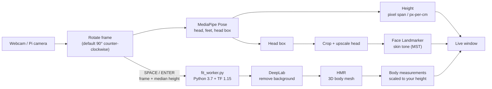

# KYRA-EtoE

One webcam, three measurements: **height**, **skin tone** and **body measurements (fit)**, shown together in a single live window.

| Module | What it gives you | Runs in |
|---|---|---|
| **Height** (`src/height`) | Person or object height in cm, live | Main Python environment (3.8+) |
| **Skin tone** (`src/skin/mst_pipeline`) | Monk Skin Tone category (MST 1-10) | Main Python environment (3.8+) |
| **Fit** (`src/fit`) | Body measurements (chest, waist, ...) from a 3D body mesh (HMR) | Separate Python 3.7 + TensorFlow 1.15 environment |

Height and skin tone update continuously. Fit runs on demand: you press **SPACE** or **ENTER** and it uses the current frame and the current measured height.

---

## Contents

1. [How it works](#how-it-works)
2. [Repository layout](#repository-layout)
3. [Setup](#setup)
4. [Running](#running)
5. [Camera rotation](#camera-rotation)
6. [Reading the output](#reading-the-output)
7. [Troubleshooting](#troubleshooting)
8. [What is not in git](#what-is-not-in-git)
9. [Porting notes (Linux / Jetson)](#porting-notes-linux--jetson)
10. [Credits and licenses](#credits-and-licenses)

---

## How it works

Two Python environments cooperate. They never share code or memory; the main pipeline starts the fit worker as a separate process and exchanges one frame and one height in, and one set of measurements out, over a local socket.



**Per frame (main environment)**

1. The camera frame is rotated once, right at capture, so the preview, the calibration and every calculation use the same coordinates (see [Camera rotation](#camera-rotation)).
2. **Height:** MediaPipe Pose finds the head and the feet. Height is `pixel span / pixels-per-cm + 1.0 cm`, using the scale from calibration. The window shows the median of the last 10 readings. A position helper compares your feet to the calibrated floor line and shows `STEP BACK`, `STEP FORWARD` or `POSITION OK`.
3. **Skin tone:** a background thread runs on the frames. Pose supplies a box around the head, which is cropped and enlarged (about 512 px) before MediaPipe Face Landmarker looks for the face, because small faces in a full-body frame are detected unreliably. Forehead and cheek regions are sampled in Lab colour and matched to the 10 Monk Skin Tone swatches. If the head crop finds nothing, it falls back to the whole frame.

**On SPACE / ENTER (fit)**

1. The pipeline sends the current frame and the median height to `fit_worker.py`.
2. The worker removes the background with DeepLab (person mask), runs HMR to get a 3D SMPL body mesh, and computes the measurements from fixed control points on the mesh. All values are scaled so the body height equals the height you sent.
3. The numbers come back and are drawn in the live window. The live view keeps running while fit works (a few seconds on CPU).

---

## Repository layout

```
Kyra-EtoE/
├── src/
│   ├── height/
│   │   ├── pipeline.py             main entry point: calibration + live window
│   │   ├── fit_client.py           starts / talks to the fit worker
│   │   ├── landmarks.py            MediaPipe Pose: head, feet, head box
│   │   ├── height_webcam.py        scale maths + calibration file read/write
│   │   ├── target_detector.py      object ROI / person detectors
│   │   ├── height_stereo.py        stereo height (not covered in this guide)
│   │   ├── validate.py
│   │   └── config/height_calibration.json    created by calibration (not in git)
│   ├── skin/mst_pipeline/
│   │   ├── pipeline.py             image -> MST category (crop-first face search)
│   │   ├── face_crop.py            head crop + upscale helper
│   │   ├── skin_extraction.py      MediaPipe / Haar face + skin regions
│   │   ├── color_normalization.py  Lab sampling, optional white balance
│   │   ├── mst_reference.py        MST 1-10 reference colours, matching
│   │   ├── color_card_correction.py
│   │   └── models/face_landmarker.task
│   └── fit/
│       ├── fit_worker.py           long-running worker (Python 3.7 env)
│       ├── extract_measurements.py measurement maths on the SMPL mesh
│       ├── patch_tf_compat.py      one-off TF 1.3 -> 1.15 compatibility patch
│       ├── inference.py            original one-shot script (image file + height)
│       ├── utils.py                measurement names / counts
│       ├── data/customBodyPoints.txt   control points for the measurements
│       ├── src/                    HMR code (RunModel, models, tf_smpl, util, ...)
│       ├── models/                 NOT in git: SMPL + HMR checkpoint
│       └── deeplab_model/          NOT in git: downloaded automatically
└── KYRA Person Height Measurement Module.docx
```

---

## Setup

Developed and tested on **Windows with PowerShell**. You need Python 3.10 (or any 3.8+) for the main environment and Python 3.7 (64-bit) for fit. Both can be installed side by side; check with `py -0`.

### 1. Clone

```powershell
git clone https://github.com/minalkrishnadev-cpu/Kyra-EtoE
cd Kyra-EtoE
```

### 2. Main environment (height + skin tone)

```powershell
py -3.10 -m venv .venv
.\.venv\Scripts\Activate.ps1
pip install opencv-python mediapipe numpy scikit-image
```

- If PowerShell blocks the activation script, run `Set-ExecutionPolicy -Scope CurrentUser RemoteSigned` once.
- The skin tone module needs MediaPipe 0.10 or newer (Face Landmarker). The model file is already in `src/skin/mst_pipeline/models/`.
- If the Haar face fallback complains about missing cascades, install `opencv-python<5`.

### 3. Fit environment (Python 3.7 + TensorFlow 1.15)

TensorFlow 1.15 only supports Python 3.7 and older, so fit needs its own environment. Keep it **outside** the repo:

```powershell
py -3.7 -m venv C:\envs\hmr37
C:\envs\hmr37\Scripts\Activate.ps1
python -m pip install --upgrade pip
pip install tensorflow==1.15.0 "numpy<1.19" "protobuf<3.21" "h5py<3" absl-py six pillow==9.5.0 opencv-python==4.5.5.64 scipy matplotlib chumpy
```

If `chumpy` fails to build, install it with `pip install --no-build-isolation chumpy`.

You do not activate this environment when running the pipeline. The pipeline launches its `python.exe` directly (see `--hmr-python` below).

### 4. Model files (not in git)

Put these four files directly in `src/fit/models/`:

```
neutral_smpl_with_cocoplus_reg.pkl
model.ckpt-667589.data-00000-of-00001
model.ckpt-667589.index
model.ckpt-667589.meta
```

They come from the HMR project's `models.tar.gz` (see https://github.com/akanazawa/hmr). That download host has been unreliable, so **keep your own backup copy of the `models` folder**.

The DeepLab segmentation model (a few hundred MB) downloads itself into `src/fit/deeplab_model/` the first time the worker starts.

> **License note:** the SMPL model file is licensed for **non-commercial research use only** and must not be redistributed. See [Credits and licenses](#credits-and-licenses).

### 5. Check that fit works on its own

With the `hmr37` environment active, from `src/fit`:

```powershell
python fit_worker.py --port 5555
```

You should see `importing HMR...`, `loading DeepLab...`, `loading HMR model...` and finally `[fit_worker] READY on port 5555`. Warnings about `cudart64_100.dll` and other CUDA libraries are normal: fit runs on the CPU. Stop it with Ctrl+C. If anything fails, see [Troubleshooting](#troubleshooting).

The HMR code in `src/fit/src` is already patched for TensorFlow 1.15. `patch_tf_compat.py` only needs to be run again if you replace that code with a fresh copy of upstream HMR.

---

## Running

Run everything from `src/height`, with the **main** environment (not `hmr37`). On Windows with several Pythons installed, `py -3.10` makes sure the right one is used.

```powershell
cd src\height
```

### 1. Calibrate (once per camera position)

Calibration turns pixels into centimetres. Do it again whenever the camera, its mount or its distance changes.

**With a reference object of known height** (recommended):

```powershell
python pipeline.py --mode webcam --target object --ref-object-cm 29.7
```

1. Stand the object upright exactly on the spot where the person will stand (29.7 cm is an A4 sheet's long edge; use any object with a known height).
2. Press **SPACE** to freeze the frame.
3. Draw a box from the very top to the very bottom of the object, then press **ENTER** to confirm (ESC aborts).

**With a person of known height** (alternative):

```powershell
python pipeline.py --ref-person-cm 175
```

Stand on the spot with the full body in view and press **SPACE**.

Both save `src/height/config/height_calibration.json`:

| Field | Meaning |
|---|---|
| `pixels_per_cm` | Scale at the standing spot |
| `calibrated_base_y` | Floor line (y pixel) used by the position helper |
| `rotation` | Camera rotation used during calibration |
| `frame_size` | `[width, height]` of the (rotated) frame |

### 2. Run the live window (height + skin tone + fit)

```powershell
python pipeline.py --mode webcam --target person --hmr-python C:\envs\hmr37\Scripts\python.exe
```

To avoid typing the path every time, set it once per terminal:

```powershell
$env:HMR_PYTHON = "C:\envs\hmr37\Scripts\python.exe"
python pipeline.py --mode webcam --target person
```

What happens:

1. The fit worker starts in the background and loads its models (about a minute). The window shows `FIT: loading models...`, then `FIT: ready - press SPACE / ENTER`.
2. Stand on the calibrated spot, full body in view. Follow the `STEP BACK` / `STEP FORWARD` hint until it reads `POSITION OK`. The height reading settles.
3. Press **SPACE** or **ENTER**. Fit runs on the current frame using the current median height, and the measurements appear on the left side of the window.
4. Press **Q** or **ESC** to quit. The worker is shut down automatically.

If you pass no `--hmr-python` (and `HMR_PYTHON` is not set), the pipeline runs height and skin tone only and prints a note that fit is disabled. `--no-fit` disables fit explicitly.

### 3. Measure a generic object (optional)

```powershell
python pipeline.py --mode webcam --target object
```

Press **SPACE** to freeze and draw a box around the object, then **SPACE** again to measure it using the calibrated scale. **Q** quits.

### Command-line options

| Option | Default | Meaning |
|---|---|---|
| `--mode` | `webcam` | `webcam` (this guide) or `stereo` (present in the code, not covered here) |
| `--target` | `object` | `person` or `object` |
| `--person-mode` | off | Force the live person window (also implied by `--mode webcam --target person`) |
| `--left-cam` | `0` | Camera index |
| `--ref-object-cm` | - | Run object calibration with this known height |
| `--ref-person-cm` | - | Run person calibration with this known height |
| `--manual-scale` | - | Use this px/cm instead of the calibration file |
| `--rotate` | `ccw90` | `none`, `ccw90`, `cw90` or `180`. Use the same value for calibration and for running |
| `--hmr-python` | `HMR_PYTHON` env var | Path to the Python 3.7 environment's `python.exe` |
| `--no-fit` | off | Do not start the fit worker |
| `--no-mediapipe` | off | Use the Haar face fallback for skin tone |
| `--use-color-card` | off | Look for a ColorChecker card to correct colours |

---

## Camera rotation

The camera is mounted so that its raw image is sideways. By default every frame is rotated **90° counter-clockwise** the moment it is captured, so:

- the preview you see is already upright,
- calibration is done in the rotated view,
- all measurements (height, face crop, fit) use the rotated coordinates.

The calibration file stores the rotation and frame size. At startup the pipeline warns you if the saved calibration was made with a different rotation or resolution (or before rotation existed) and tells you to recalibrate. If the mount changes, pass `--rotate none|cw90|180` to **both** the calibration command and the run command.

---

## Reading the output

**Height.** The module targets about ±1-2 cm when the person stands exactly where the reference object stood. Standing closer or farther than the calibrated spot, or a tilted camera, changes the scale and therefore the height.

**Skin tone.** MST category 1 (lightest) to 10 (darkest), chosen by the nearest match in Lab colour (CIEDE2000). The terminal summary shows confidence, the regions used and whether the face was found `via: face_crop` or `full_frame`. Skin tone needs decent, even lighting: in a dark room the face may not be found and colours are unreliable even if it is.

**Fit.** Measurement names and the number of measurements come from `src/fit/utils.py`. Accuracy notes:

- Every measurement is scaled by the height you supply, so a height error carries into all of them.
- HMR pulls body shape toward an average body. Most people come out within a few cm, but people noticeably larger or smaller than average can be off by more.
- Best results: full body in view, feet visible, arms slightly away from the body, fitted clothing, plain background.
- A per-measurement correction fitted from tape-measure data is the planned way to reduce the large-body/small-body error.

---

## Troubleshooting

| Symptom | Cause and fix |
|---|---|
| `ImportError: cannot import name 'Literal' from 'typing'` | You ran `pipeline.py` in the Python 3.7 environment. Run `deactivate`, then use the main environment (`py -3.10 pipeline.py ...`). |
| `HMR model files not found. Expected folder: ...\src\fit\models` | The four model files are missing from `src/fit/models/`. See [Model files](#4-model-files-not-in-git). |
| Lots of `cudart64_100.dll ... not found` warnings | Harmless. TensorFlow 1.15 cannot use newer GPUs, so fit runs on the CPU. |
| `DuplicateFlagError: The flag 'log_dir' is defined twice` | You are using an old `src/fit/src/config.py`. The current one skips the duplicate definition. |
| `TypeError: default_name type (<class 'list'>) is not a string type` | HMR code not patched for TF 1.15. Run `python patch_tf_compat.py` from `src/fit` (backups are saved as `.orig`). |
| `ModuleNotFoundError: No module named 'chumpy'` | `pip install chumpy` in the `hmr37` environment (or `--no-build-isolation`). |
| Window shows `FIT: unavailable` | Open `src/fit/fit_worker.log`. Usual causes: wrong `--hmr-python` path, missing model files, or a package missing in `hmr37`. |
| Fit panel says `No person found in the frame` | DeepLab could not segment a person. Check lighting and that the whole body is in view. |
| `Calibration was saved with rotation=...` / `frame size ... differs` | Calibration does not match the current camera view. Re-run calibration. |
| Skin tone stays at `Scanning face...` | Face not found, usually from low light or the head being turned away. Improve front lighting; look at the `FACE ROI` box in the preview to see where the face search is looking. |
| Height readings jump or are consistently off | Check that the person stands on the calibrated spot, the camera is level, and recalibrate if anything moved. |
| The model download link does not resolve | The HMR download host is sometimes unreachable. Use your backup copy of the `models` folder. |

---

## What is not in git

These are listed in `.gitignore` and must be set up on each machine:

- `src/fit/models/` - SMPL model and HMR checkpoint (large, SMPL is license-restricted)
- `src/fit/deeplab_model/` - downloaded automatically on first run
- The `hmr37` virtual environment (and any other venv)
- `src/height/config/height_calibration.json` - specific to your camera and mount; recalibrate per setup
- `fit_worker.log`, `__pycache__/`, `*.pyc`, `*.orig`

---

## Porting notes (Linux / Jetson)

Not tested yet; things that will need attention:

- Paths: the venv path for `--hmr-python` becomes e.g. `/home/you/envs/hmr/bin/python`.
- TensorFlow: use NVIDIA's TensorFlow 1.15 build for your JetPack version and the Python version it supports. `fit_worker.py` does not need Python 3.7 specifically.
- MediaPipe, OpenCV and NumPy need ARM64 builds; verify that MediaPipe installs on your JetPack.
- Camera: `_open_camera()` tries `cv2.CAP_DSHOW` (Windows) first and falls back to other backends. A CSI camera usually needs a GStreamer pipeline.
- The live window needs a display (monitor or remote desktop) for the preview and key presses.
- Recalibrate for the new camera.

---

## Credits and licenses

- **HMR** (End-to-end Recovery of Human Shape and Pose, Kanazawa et al., CVPR 2018): https://github.com/akanazawa/hmr - the code in `src/fit/src` is adapted from it, with `tf_smpl/LICENSE` kept alongside.
- **SMPL** body model (Loper et al.): https://smpl.is.tue.mpg.de - free for **non-commercial research and education only**. Redistribution of the model files is not permitted, and any commercial use (including in a product or service) requires a separate license from Meshcapade. Do not commit the SMPL files to this repository.
- **DeepLab v3** (TensorFlow models): https://github.com/tensorflow/models/tree/master/research/deeplab
- **MediaPipe** (Pose and Face Landmarker): https://ai.google.dev/edge/mediapipe
- **Monk Skin Tone Scale:** https://skintone.google

Add this project's own license here.
